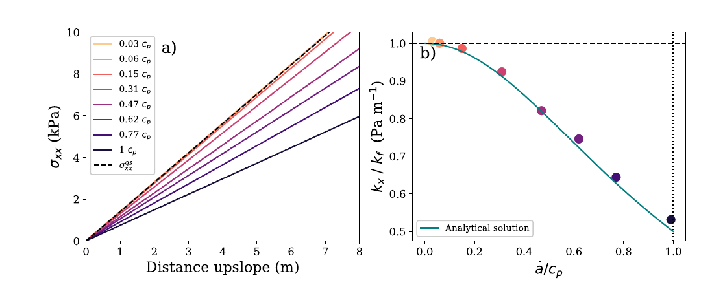
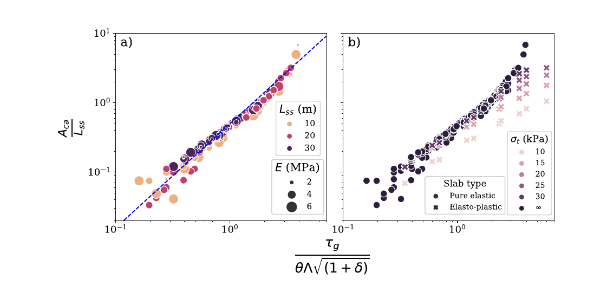
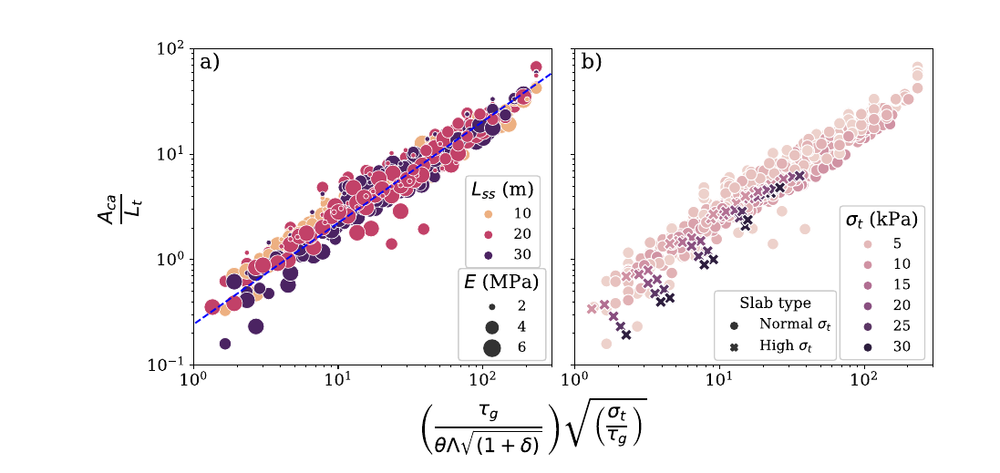
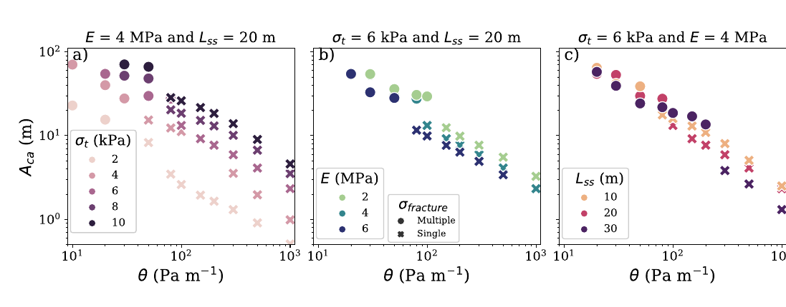
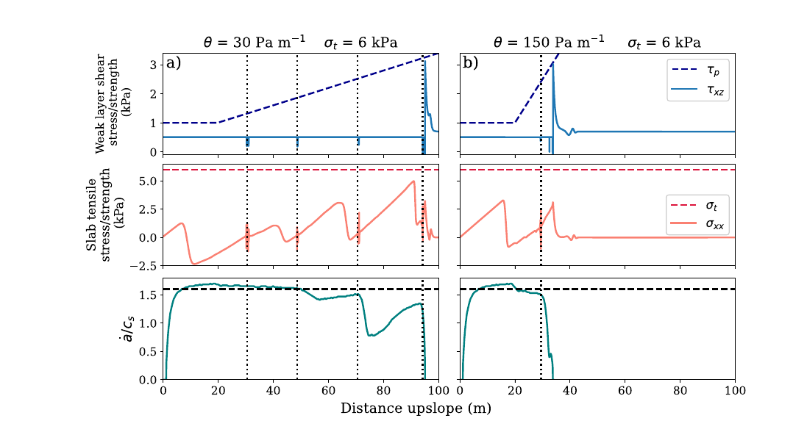
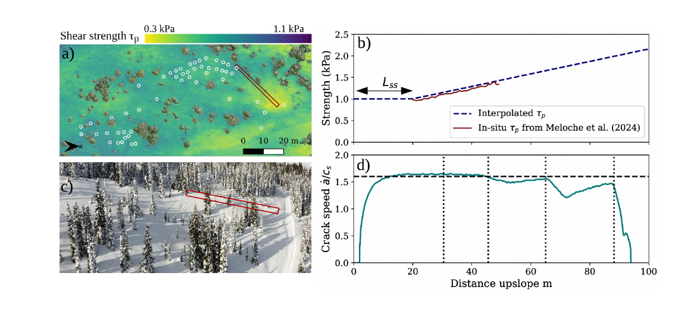
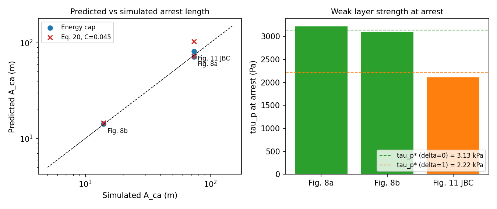

# arrest_indices.py: methods

Crack-arrest indices for dry-slab avalanches in two groups:

1. **Published strength-based scalings** from Meloche et al. (2025, JGR) and Meloche et al. (ISSW 2026).
2. **An energy-cap hypothesis** (new, untested beyond three simulated cases) that treats slab fracture as a cap on the energy available to drive the weak-layer crack.

Status: smoke-tested against three runs from Meloche et al. (2025). Not validated against field data or a broad simulation set.

Units are SI (Pa, m, kg m⁻³, J m⁻²) with angles in degrees.

Figures marked "JGR" are reproduced from Meloche et al. (2025), *JGR Earth Surface*, open access under CC BY 4.0. Image files are in `figures/`.

---

## 1. Notation

| Symbol | Meaning | Code |
|---|---|---|
| ρ, h | slab density, slab thickness (slope-normal) | `rho`, `h` |
| E, ν | slab Young's modulus, Poisson's ratio | `E`, `nu` |
| E′ = E/(1−ν²) | plane-stress modulus | `plane_stress_modulus` |
| G = E/(2(1+ν)) | slab shear modulus | `shear_modulus` |
| σt | slab tensile strength | `sigma_t` |
| G_wl, D_wl | weak-layer shear modulus, thickness | `G_wl`, `D_wl` |
| K_wl = G_wl/D_wl | weak-layer interface stiffness (Pa/m) | `weak_layer_stiffness` |
| τp, τp0 | weak-layer shear strength, value at trigger zone | `tau_p0` |
| θ | upslope gradient of τp (Pa/m) | `theta` |
| δ | weak-layer softening coefficient, (u_r − u_c)/u_c | `delta` |
| ψ, φ | slope angle, snow friction angle (27°) | `psi_deg`, `phi_deg` |

Check on K_wl: the JGR paper states "K_wl = 0.2 MPa" but also u_c = 0.2 mm at τp = 1 kPa. Only K_wl = G_wl/D_wl = 0.2 MPa / 0.04 m = 5 MPa/m reproduces u_c = 0.2 mm, so the code uses G_wl/D_wl.

---

## 2. Published relations (Meloche et al. 2025, ISSW 2026)

**Elastic length (upslope, mode II)**

Λ = √( E h D_wl / ((1−ν²) G_wl) )

**Gravitational and residual shear**

τg = ρ g h sin ψ, τr = ρ g h cos ψ tan φ

Shear propagation is only sustained when ψ > φ (`sustained` flag).

**Slab tension gradient.** Quasi-static (Eq. 17):

k_f = ρ g sin ψ (1 − tan φ / tan ψ)

Dynamic (Eq. 18), with crack speed ȧ = 1.6 c_s (supershear):

k_x = k_f c_p² / (c_p² + ȧ²), c_p = √(E′/ρ), c_s = √(G/ρ)

*JGR Fig. 3. Faster cracks build slab tension more slowly. At ȧ ≈ c_p the gradient is half the quasi-static value.*

**Tensile lengths (distance to first slab fracture)**

L_t = σt / k_f, L_dyn = σt / k_x

**Arrest length, elastic slab (Eq. 19)**, for reference (not coded):

A_ca / L_ss ∝ ( τg / (θ Λ √(1+δ)) )^(3/2)

*JGR Fig. 7. Elastic-slab collapse (a). In (b), brittle runs fall off the elastic trend, which shows slab fracture changes the arrest mechanism.*

**Arrest length, brittle slab (Eq. 20)**

A_ca / L_t = C · X · √(σt/τg), X = τg / (θ Λ √(1+δ))

The paper gives this as a proportionality. C = 0.045 is my two-point fit to the Fig. 8 runs and is the code default.

*JGR Fig. 10. Brittle-slab scaling with a slope-1 reference line.*

Unresolved discrepancy: by my reading, the dashed line in Fig. 10a sits near A_ca/L_t ≈ 0.25 × (x-axis value), which implies C ≈ 0.25. Recomputing the x-axis value from the stated Fig. 8 inputs gives C ≈ 0.045. A factor of ~5 suggests the paper defines τg, Λ or L_t differently from my reading (for example, the slope-normal versus vertical h, or a different Λ). Check against the paper's repository before trusting either value.

*JGR Fig. 9. A_ca falls roughly as 1/θ. Higher σt and lower E lengthen arrest. Crosses are single-fracture arrests, circles multiple.*

**Release size index (ISSW 2026, preliminary).** a_t is taken as L_dyn:

- RSI 1 (arrest): a_t/a_c < 6–7 (code uses 6.5)
- RSI 2 (sub-Rayleigh en-echelon): a_t/a_c ≥ 6.5 and a_t/a_sc < 1
- RSI 3 (supershear en-echelon): a_t/a_sc ≥ 1

a_c and a_sc are not computed. The TARP report's a_sc formula was unreadable in the PDF extraction, and my reconstruction gave negative values, so these must be supplied.

---

## 3. Energy-cap hypothesis

### Idea

During propagation the unsupported slab stores elastic energy, which pays for weak-layer fracture at the crack tip. A slab fracture resets the tension upslope of it to zero. The energy the slab can deliver per unit crack advance is therefore capped at roughly that of a segment loaded to its tensile strength. Arrest occurs where the weak layer's fracture energy exceeds that cap.

### Slab energy cap

For a slab strip with tension rising to σt, the energy delivered per unit advance at the loaded end is:

G_slab = σt² h / (2E′)

### Weak-layer fracture energy

Integrating the softening interface law of Meloche et al. (2025, Eq. 15), linear to (u_c, τp) and then linear down to τr at u_r = u_c(1+δ), and approximating:

G_c(τp) ≈ (τp − τr)² (1+δ) / (2 K_wl)

The code uses τr = 0 by default (`use_residual=False`). That is the version that matched the simulations below. Including τr is an option, not a recommendation.

### Arrest criterion

Arrest when G_c(τp(x)) ≥ R · G_slab.

This defines a critical weak-layer strength:

τp* = τr + √( 2 K_wl R G_slab / (1+δ) )

For a linear strength ramp τp(x) = τp0 + θx beyond the steady-state zone:

A_ca = (τp* − τp0) / θ

R absorbs dynamic effects and the approximations above. Two options are provided:

- `R = 0.48`: fitted to the two Fig. 8 runs (default).
- `R = 'dynamic'`: R = k_x/k_f at ȧ = 1.6 c_s (0.53 for ν = 0.3). This is a speculative physical interpretation. It lands within 10% of the fit, which may be coincidence.

*JGR Fig. 8. Weak-layer strength and shear (top), slab tension and slab fractures (middle), crack speed (bottom). Arrest at 94 m (θ = 30) and 34 m (θ = 150).*

*JGR Fig. 11. Field gradient (θ ≈ 15 Pa/m) with δ = 1. Crack speed drops to zero near 94 m in panel (d).*

### Check against Meloche et al. (2025)

Inputs: ρ = 250 kg m⁻³, h = 0.5 m, ψ = 35°, E = 4 MPa, σt = 6 kPa, G_wl = 0.2 MPa, D_wl = 0.04 m, τp0 = 1 kPa, L_ss = 20 m.

| Run | θ (Pa/m) | δ | Observed A_ca (m) | Energy cap (m) | Eq. 20, C = 0.045 (m) |
|---|---|---|---|---|---|
| Fig. 8a | 30 | 0 | 74 (arrest at 94 m) | 71 | 73 |
| Fig. 8b | 150 | 0 | 14 (arrest at 34 m) | 14 | 15 |
| Fig. 11, JBC | 15 | 1 | ~74 (arrest ~94 m, read from Fig. 11d) | 81 | 103 |

The first two rows are the calibration data for both methods, so they don't discriminate. JBC is the only out-of-sample point, and its observed value is read off a plot.

*My plot from `arrest_indices.py`. The dashed lines on the right are τp* from the energy-cap criterion with R = 0.48.*

The notable observation is that both Fig. 8 runs arrest at nearly the same weak-layer strength (3.2 and 3.1 kPa) despite a fivefold change in θ. A threshold-strength criterion predicts exactly this behavior.

### How the two frameworks differ

Both give A_ca ∝ 1/θ, so they can only be separated through other parameters:

| Parameter | Energy cap | Eq. 20 |
|---|---|---|
| σt | A_ca roughly ∝ σt | ∝ σt^1.5 |
| E | through √(1/E′) in τp* | through Λ and L_t |
| δ | through (1+δ)^(−1/2) in τp* | through (1+δ)^(−1/2) in X |

The σt dependence is the cleanest discriminating test.

### Cross-slope (mode III), hypothesis only

The code provides:

- `elastic_length_cross`: Λ_III = √( G h D_wl / G_wl ), giving Λ_III/Λ_II = √((1−ν)/2) ≈ 0.59 at ν = 0.3. This is my derivation, using the slab shear modulus for antiplane loading.
- `slab_energy_cap_cross`: G_slab,III = τ_flank² h / (2G), where τ_flank is a slab flank (shear) strength. No parameterization exists, so it is a user input.

Expected differences from upslope, not yet simulated:

- Mode III cracks cannot exceed c_s (Broberg 1989), versus ~1.6 c_s upslope. This caps the energy flux and is a plausible reason cross-slope cracks stop more easily.
- Because G < E′, an equal-strength slab has a larger energy cap cross-slope. If that holds, cross-slope arrest is driven mainly by the speed cap and weak-layer variability, not slab fracture. This is consistent with the JGR paper attributing lateral arrest to weak-layer heterogeneity.

---

## 4. Inputs from SNOWPACK

| Input | Source | Note |
|---|---|---|
| ρ, h | layer-weighted slab density and thickness above weak layer | check slope-normal vs vertical |
| E | density parameterization | not a default output |
| σt | density parameterization (e.g. Sigrist 2006) | formula not included here |
| τp0 | shear strength output (`.pro` code 0508, to verify) | |
| G_wl, D_wl | weak-layer modulus and thickness | paper used 0.2 MPa, 0.04 m |
| θ | `shear_gradient` on τp along an upslope transect | needs a spatial field, not one profile |
| δ | not observable | paper range 0–2 |

Without θ, the energy framework still gives τp* and R0 = G_c(τp0)/G_slab, a per-profile index of how far weak-layer strength must rise before a crack stops.

---

## 5. Limits

- All calibration comes from shear-mode-only DA-MPM simulations: 0.5 m slab, ρ = 250 kg m⁻³, ψ = 35°, E 2–6 MPa, σt 2–10 kPa. The JGR paper notes the model suits large avalanches (size 3+) and may overestimate soft slabs.
- No anticrack (collapse) regime and no slab bending.
- Linear strength ramp only. Noisy or patchy weak layers may behave as a percolation problem rather than a gradient problem.
- R and C rest on two runs.

## 6. Suggested validation

1. Pull the post-processed brittle runs from https://github.com/Francismeloche/CrackArrest-DAMPM.
2. For each run, compute τp at the arrest point and R = G_c/G_slab.
3. Check whether R is constant across θ, σt, E, L_ss and δ. If it is, the energy-cap criterion holds in the simulated range.
4. Compare the σt dependence of A_ca against Eq. 20.
5. Repeat on the TARP cross-slope runs with `slab_energy_cap_cross` once a flank strength is chosen.

## 7. References

- Meloche, F., Bobillier, G., Guillet, L., Gauthier, F., Langlois, A., & Gaume, J. (2025). Modeling crack arrest in snow slab avalanches: Toward estimating avalanche release sizes. *JGR Earth Surface*, 130(12), e2025JF008470. https://doi.org/10.1029/2025JF008470
- Meloche, F., Trottet, B., Bobillier, G., & Gaume, J. (2026). Slab fractures during dynamic crack propagation in dry-snow slab avalanches. *Proc. ISSW*, Whistler, 1961–1966. https://doi.org/10.15788/1790098485
- Meloche, F., et al. (2026). TARP final technical report: Vertical avalanche defense structures.
- McClung, D. M., & Schweizer, J. (2006). Fracture toughness of dry snow slab avalanches from field measurements. *JGR Earth Surface*. https://doi.org/10.1029/2005JF000403
- Broberg, K. B. (1989). The near-tip field at high crack velocities. In *Structural Integrity*, Springer.
