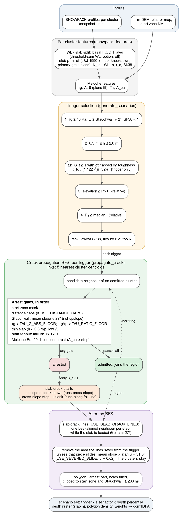
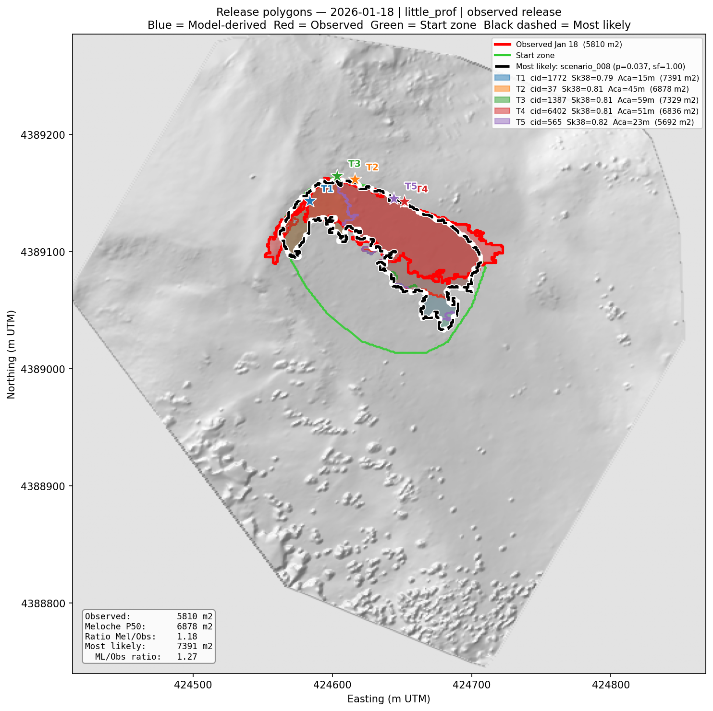
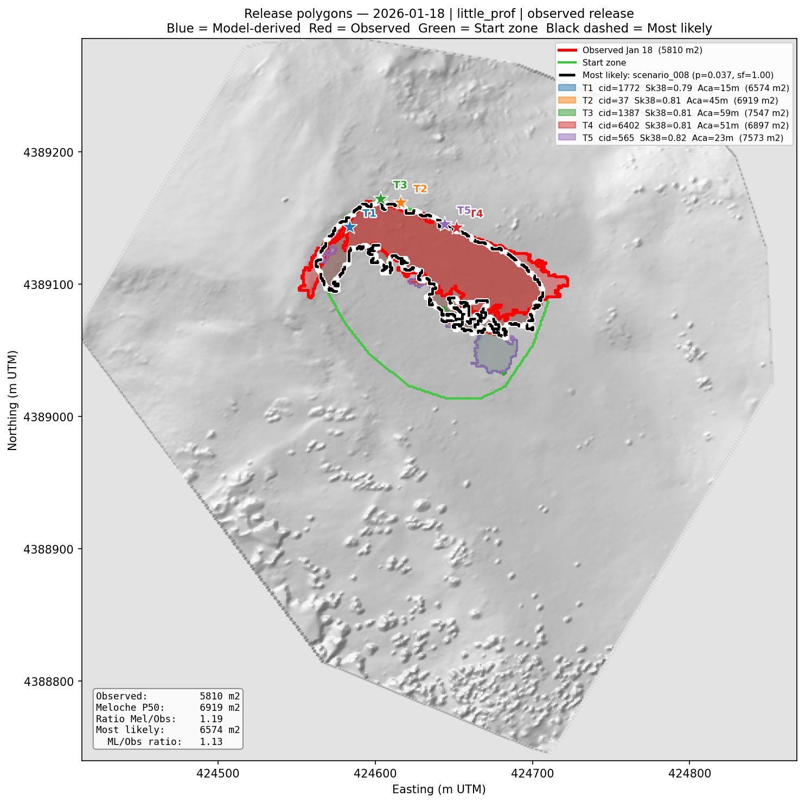
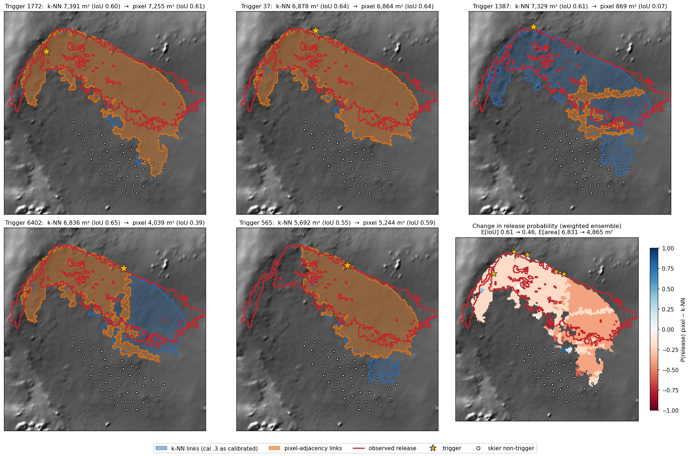

# Release Area Geometry: Method Documentation

**Project:** Little Professor avalanche path, Loveland Pass (US-6), Colorado
**Pipeline step:** `step_scenarios` in `analysis_pipeline.py`
**Key modules:** `release_geometry.py`, `snowpack_analysis.py`, `arrest_indices.py`, `calibration.py`, `scenario_writer.py`
**Last updated:** 2026-11-13 (calibration 2026-11-10.3; branch `feat/thin-slab`: severed-slab slides, primary-class facet rule, 0.3 m slab floors, threshold-sum weak layer as an option, two deferred switches)

This document describes the model as it runs in avachain. The physics is the
same as in the standalone reference implementation, `~/avalanche-release-areas`.
Its methods document, `docs/release_area_methods.md`, is the detailed record:
derivations, measurements and the history of each choice. This one is the
operational summary. Where the two disagree, the code and CLAUDE.md's
feature-flag table win. The version of this file before 2026-11-10 described
the May 2026 model (symmetric jump factors, a relative τg drop, a 28°
Stauchwall, a 3 902 m² mapped crown); it is in git history.

---

## 1. Overview

The pipeline turns distributed SNOWPACK profiles into release polygons for the
com1DFA flow model (AvaFrame). For each forecast it selects trigger clusters,
grows a release region from each by a crack-propagation flood fill (BFS) with
physical arrest gates, cuts the region along slab cracks, and writes an
ensemble of weighted scenarios.



The source of this figure is `assets/release_model_flow.dot`, a renamed copy of
the standalone's `docs/figures/release_model_flow.dot`. Re-render both when the
chain changes.

**Calibration.** Since 2026-11-08 the release model is calibrated to the
2026-01-18 avalanche (CLAUDE.md, "Calibration"). Calibrated values live in the
slope TOML `[calibration]`, never in module constants, and every report states
the calibration version. Jan 18 is therefore a calibration target and a
regression test, **not** evidence of skill. Little Professor runs calibration
2026-11-10.3 (§7).

**Probabilistic boundary model.** The logistic boundary model of the May
version (`probabilistic_release.py`) is dormant. Nothing in the pipeline calls
it, and its fitting script is gone. With one event it had no boundary recall
(ROC-AUC 0.59). Revisit it after several events.


The 2026-01-18 skier-triggered slab avalanche, the only avalanche of the
2025-26 season on Little Professor (Ron). The release area used as the target
is the survey-derived polygon, 5 810 m² (`data/validation/avalanche_release_area_20260118.geojson`,
from the 01-14 → 01-20 UAS surveys). People skied 10–20 m from the crown that
day without triggering it; those points are the propagation constraint (§7).

---

## 2. Inputs

### 2.1 Distributed SNOWPACK

SNOWPACK runs at every cluster of the 1 m DEM inside the survey domain (6 565
clusters on Little Professor; k-means, a few to tens of pixels each). The Zarr
store (`cfg.zarr_path`) holds one profile per cluster and time. Its units are
metres (CLAUDE.md, "The Zarr store"). The DEM series is NAD83(2011)
ellipsoidal heights, EPSG 6342.

### 2.2 Features (`step_analyze`)

`analyze` writes two CSVs per snapshot to `outputs/<slope>/analysis/`:

- `all_start_zone_features_<date>.csv`: per-cluster slab and weak-layer (WL)
  properties from `profile_features`. The basal WL is the persistent
  faceted layer found by the WL/slab split. The slab is everything above it.
- `meloche_features_all_<date>.csv`: the Meloche et al. (2025) quantities from
  `compute_meloche_features`.

Columns the release model uses:

| Column | Meaning |
|---|---|
| `slab_thickness`, `slab_density`, `slab_grain_size` | slab h (m), ρ (kg/m³), grain size (m) |
| `sigma_t_mean__jamieson1990` | slab tensile strength: Jamieson & Johnston (1990), 79.7 (ρ/917)^2.39 kPa per layer, times the facet knockdown (1 − a f), thickness-averaged. f = 1 for a primary faceted class (FC, DH, FCxr), 0 otherwise (`FACET_SOURCE = 'grain_class_primary'` since 2026-11-13; `'grain_class'` also counted RG/DF/PP with a faceted secondary). a = `FACET_STRENGTH_FACTOR` (0.5 default, 0.75 by calibration) |
| `K_Ic_ligament` | fracture toughness of the slab layer above the WL, Schweizer et al. (2004) Eq. 8, extrapolated past its 80–300 kg/m³ range (`K_IC_RANGE_MODE = 'extrapolate'`) |
| `wl_shear_strength` | WL shear strength τp (Pa). In SNOWPACK it is a function of WL density alone |
| `rc_wl` | SNOWPACK critical cut length r_c (code 0606) over the WL |
| `min_sk38` | skier stability index at the WL interface |
| `tau_g` | driving shear stress τg = ρ g h sin ψ (Pa) |
| `Lambda` | slab elastic length Λ (E from van Herwijnen et al. 2016, G_wl = 0.2 MPa) |
| `theta` | WL shear-strength gradient θ (plane fit over L_ss = 20 m) |
| `Pi1_elastic`, `A_ca_brittle` | Π₁ = τg/(θ Λ √(1+δ)) and the brittle arrest length (Eq. 20, C = 0.045) |

Arrest indices are only computed where τg ≥ `TAU_G_FEATURE_FLOOR` (50 Pa). The
trigger gate uses 40 Pa. The 40–50 Pa band is a known open item (CLAUDE.md).

**Facet rule (2026-11-13, Ron).** In the Jan 18 release the top 0.45 m of the
slab is 51% rounded grains with a faceted secondary (RG/FC) and 6% pure RG.
Under `'grain_class'` these mixed grains took the full facet knockdown, so a
thin slab was 0.44× as strong in tension as the same slab scaled from the
basal one. With `'grain_class_primary'` they keep RG strength (1.00×). The
start-zone median f falls from 0.97 to 0.79.

**Weak-layer selection (`WL_SELECTION`, default `'basal'`).** `'basal'` is the
basal FC/DH block, the operational choice because the forecast cares about the
larger avalanches (Ron, 2026-11-12). `'threshold_sum'` picks the interface
with the most threshold-sum "lemons" (Schweizer & Jamieson 2007; `TSA_*`
thresholds; CLI `analyze --wl-selection`). On Jan 18 it puts the release slab
at 0.47 m median against the surveyed 0.44 m (basal 1.40 m), but it **cannot
be calibrated** (§8 item 8).

### 2.3 Masks

- Start zone KML: the hard outer boundary of the BFS (`MASK_MODE = 'gate'`).
- The survey release polygon: scoring only, via `[paths] validation_dir`. It
  is off in the operational runs.

---

## 3. Trigger selection

Implemented in `step_scenarios` / `_model_triggers` (`analysis_pipeline.py`).
The pool is every start-zone cluster with a features row. Filters, in order:

| Stage | Keeps a cluster when | Constant |
|---|---|---|
| 1 | τg ≥ 40 Pa, mean slope ≥ Stauchwall + 2° (= 31°), Sk38 < 1.0 | `MIN_TAU_G`, `stauchwall_deg`, `MAX_SK38` |
| 2 | 0.3 m ≤ h ≤ 2.0 m (a missing h passes; 0.5 m until 2026-11-13) | `MIN_SLAB_THICKNESS`, `--max-slab-thickness` |
| 2b | S_t ≥ 1 at the trigger, σt capped by toughness (below) | `USE_SLAB_TENSILE_GATE`, `USE_TRIGGER_TOUGHNESS` |
| (validation) | overlaps the observed release | `--restrict-to-release-area` |
| 3 | elevation ≥ P50 of the survivors (P75 in validation mode) | relative |
| 4 | Π₁ ≥ median of the survivors | relative |
| rank | lowest Sk38 first, ties by lowest r_c; top N (5) | `_rank_triggers`, `n_triggers` |

**Trigger tensile gate with toughness (2b).** A trigger is rejected when its
slab would break in tension before its own weak-layer crack reaches r_c:
S_t = σ_eff / (3 ρ g r_c² / h) < 1 (Schweizer et al. 2014, Eq. 1). At the
trigger σ_eff = min(σt, K_Ic / (1.122 √(π h/2))): an edge crack of depth h/2 in
the slab (`cluster_tensile_support`). On Jan 18 the cap is below σt
everywhere, so trigger strength is ~1.2 kPa and is set by K_Ic and h. This
gate took the Jan 18 ski points from 13/46 releasing to 0/46. The flaw depth
h/2 and F = 1.122 are assumptions, not measurements.

**Stages 3 and 4 are relative**, so the chain returns triggers on every day
that passes stage 2b. That is why the model false-alarms on every no-event day.
A no-event day says nothing about release *area* (CLAUDE.md), but it does bear
on initiation.

**Validation of each trigger.** Each ranked trigger is run once through
`make_release_polygon_2d` at the middle size factor. One that gives no polygon
is dropped, and the next candidate is **not** promoted, so a run can have
fewer than N triggers. If all fail, the set is kept with the rectangle
fallback.

**A_ca** comes from `A_ca_brittle`, 50 m if missing, capped at 300 m. There is
no floor on A_ca itself. `D_UP_MIN_M = 20` m applies only inside the distance
caps.

**No candidates.** The triggers become the clusters under
`[scenarios] explosive_trigger_points`: [lat, lon] points, never cluster IDs.
They skip the gates and the ranking and get equal weight
(`trigger_source = 'explosive_fallback'`). With no points the set is empty. A
day with no snow (max HS below `MIN_RELEASE_DEPTH_M`) publishes an empty
`no_snow` set.

**Forced shots.** With `force_explosive_triggers` (on for Professor_PTC),
every run also publishes `<date>/shots/`. Every shot point is a trigger, with
no initiation gate and no rectangle fallback: "they will trigger, the question
is will it propagate" (Ron). Weights are 1/N per shot and are not
renormalised. `p_no_release` = 1 − Σw is the share of shots that propagate
nothing. The runout runs it as a second set.

---

## 4. Crack propagation (BFS)

`propagate_release` in `release_geometry.py`, `ARREST_MODE = 'legacy'`. Every
BFS parameter sits in the **PROPAGATION MODEL** section of `model_params.py`
(since 2026-11-11; before that, at the top of `release_geometry.py`). None is a
literal inside the functions.

### 4.1 Flood fill

The graph joins each cluster to its 8 nearest centroids (`BFS_K_NEIGHBOURS`,
`BFS_ADJACENCY = 'knn'`). These links need not share a pixel edge, so a crack
can reach a cluster past one it arrested in (§8 item 9). From the trigger, each
ring tests every unvisited neighbour of the clusters admitted in the previous
ring. A candidate that passes every gate is admitted; one that fails any gate
is arrested and blocks that route. `MAX_BFS_CLUSTERS = 2000` is a safety cap,
not physics. Jan 18 regions saturate near 1 000 clusters, and a run that hits
the cap prints `[CAP-BOUND]`.

Direction is measured from the trigger centroid in the map frame against the
trigger's fall line: downslope within ±45°, upslope within ±45° of the
opposite, cross-slope otherwise. Never derive directions from array axes
(CLAUDE.md).

### 4.2 Arrest gates, in order (`_qualifies`)

| Gate | Constant | Default | Note |
|---|---|---|---|
| Outside the start zone | — | hard | |
| Distance caps: up A_ca, down to the Stauchwall, cross the Gaume width (floors 20/20/15 m) | `USE_DISTANCE_CAPS`, `D_*` | on | **off** on Little Professor (`[calibration] distance_caps = false`) |
| Stauchwall: mean cluster slope < angle, not upslope | `STAUCHWALL_DEG` | 29° | three copies, keep equal (CLAUDE.md) |
| Driving stress floor | `TAU_G_ABS_FLOOR` | 350 Pa | inert on Jan 18 (start-zone min 409 Pa) |
| Load-to-strength floor τg/τp | `TAU_RATIO_FLOOR` | 0 (off) | **0.65** on Little Professor |
| Thin slab | `MIN_PROPAGATION_SLAB` | 0.3 m | 0.5 m until 2026-11-13 |
| Compliant slab | `MIN_PROPAGATION_LAMBDA` | 0.1 m | never reached on Jan 18 |
| Slab tensile failure S_t < 1 (plain σt) | `USE_SLAB_TENSILE_GATE` | on | **starts a slab crack** (§4.3) |
| Meloche Eq. 20 directional arrest: A_ca along the directed τp gradient shorter than the step | `USE_MELOCHE_ARREST`, `C_FIT` | on, C = 0.045 | |

While `USE_MELOCHE_ARREST` is on, `_qualifies` returns after the Meloche test,
so the Λ and thickness discontinuity gates (`LAMBDA_*`, `THICKNESS_*`
DROP 0.20 / RISE 0.30) are **dead**. They stay in the block for the
flag-off path.

### 4.3 Running slab cracks (`USE_SLAB_CRACK_LINES`, on since 2026-11-10)

A release boundary is a fracture in the slab. The tensile gate says where the
slab first breaks. Once broken, the crack runs along the slab as a crown or a
flank, even through clusters whose own S_t is above 1.

1. **Initiation.** A cluster arrested by the tensile gate starts a crack,
   oriented by the step that reached it. An upslope step starts a
   **crown**, which runs cross-slope. A cross-slope step starts a **flank**,
   which runs along the fall line. A downslope step starts none: that side is
   in compression.
2. **Running** (`slab_crack_lines`, after the BFS). Each crack runs both ways
   as a line, one best-aligned neighbour per step (within 45°,
   `SLAB_CRACK_ALIGN_COS`). It runs only while the slab there is loaded:
   - inside the admitted region;
   - with detached slab below a crown, or beside a flank, within
     `SLAB_CRACK_BAND_M` = 5 m;
   - with the band-mean slope above `FRICTION_DEG` = 27°.

   It stops outside the region, at the trigger, or where the slab is
   unloaded. Lines may cross, so the result does not depend on processing
   order.
3. **Cut.** The area the lines sever from the trigger (4-connected pixels) is
   removed. The line clusters stay, because they are the boundary.
4. **Severed slab slides** (`USE_SEVERED_SLIDE`, on since 2026-11-13). A
   severed piece is part of the same broken slab. Each connected piece is
   kept in the release when its mean cluster slope exceeds atan μ, with
   μ = `SEVERED_SLIDE_MU` = 0.62 (31.8°): the crack-face friction at which
   slabs came to rest in van Herwijnen & Heierli (2009). Only a gentler piece
   is removed. Without it, on a 0.45 m slab, the lines severed ~410 clusters
   at the neck of the release and the area jumped between ~650 and ~7 800 m²
   with the facet knockdown a (a knife edge). With it, area falls smoothly as
   a rises (a = 0.75 → 4 653 m², 0.6 → 5 785, 0.5 → 6 412). On calibration
   .3 it changes one trigger (565, 5 692 → 7 292 m²).

**No toughness test in the running step.** With the net weight of the detached
slab as the load (full, or Stauchwall- and flank-supported), K was 10–75× the
slab K_Ic at every step on Jan 18. To stop a crack ~3 m long, the slab stress
must be under ~0.5 kPa. A detached slab at 38° passes that within ~1.5 m of
span. So a slab crack a few metres long is unstable, and the running test is
geometric. Toughness binds only at the trigger scale (§3).

Two versions were rejected (standalone methods §5 has the numbers):
- Running the crack inside the BFS made the result depend on visiting order.
- Letting a line continue to every neighbour within ±45° flooded the region.

### 4.4 Polygon

`make_release_polygon_2d` rasterises the admitted clusters and keeps the
largest part (`POLYGON_PIECE = 'largest'`), after the rasterise and again after
the clip to start zone and Stauchwall. On calibration .3 the trigger is in the
largest part for all five triggers (19–289 px dropped, IoU change ≤ 0.02).
`'trigger'` keeps the part holding the trigger instead; it is deferred to the
next recalibration together with pixel links (§8 item 9). It fills interior holes and clips to the start zone. A polygon
under `MIN_POLYGON_AREA` (200 m²) is dropped. If the BFS gives nothing, a model
trigger falls back to an oriented rectangle built from A_ca, the Stauchwall
walk and the Gaume width. Two cases get no rectangle and no release: a
trigger whose own S_t < 1, and a forced shot.

### 4.5 Switches

Two switches are implemented but stay at their old behaviour until the next
recalibration (Ron, 2026-11-13): `BFS_ADJACENCY` (`'knn'`; `'pixel'` links
only clusters that share a pixel edge) and `POLYGON_PIECE` (`'largest'`;
`'trigger'`). They are avachain-only so far; their defaults equal the
standalone's behaviour.

CLI `--[no-]slab-tensile-gate`, `--[no-]trigger-toughness`,
`--[no-]distance-caps` and `--[no-]slab-crack-lines` override the defaults.
`--distance-caps` also overrides the TOML. CLAUDE.md's feature-flag table is
the list of record, including the flags that are off (mode III Λ and speed
cap, anisotropic rings, the energy mode).

---

## 5. Scenario ensemble and output

**Axes:** triggers × size factors × depth percentiles.

- **Defaults:**
  - five triggers;
  - size factors 0.70, 0.85, 1.00, 1.15, 1.30 (times `[calibration]
    size_scale` if set);
  - depth percentiles 10, 50, 90.
- **What size_factor scales:** only the distance caps and the rectangle
  fallback. The Λ/thickness factors are dead under Meloche arrest. With the
  caps off on Little Professor, **the model BFS polygon does not change with
  size factor**. The size axis there only reweights identical polygons, and
  differs only where a rectangle is used.
- **Depth:** per-cluster `slab_thickness` inside the polygon, with 0.8 × HS
  (metres) where it is missing. It is scaled 0.75 / 1.00 / 1.30 for P10 / P50
  / P90. A scenario whose mean depth is below 0.10 m (`MIN_RELEASE_DEPTH_M`)
  is dropped.
- **Density:** the median `slab_density` of the clusters inside the scenario's
  polygon, 280 kg/m³ when there is none (`_polygon_density`). It goes straight
  to com1DFA.
- **Weights:**
  - trigger: 1/Sk38, normalised (model triggers only);
  - size: log-normal over the factors;
  - depth: 0.2 / 0.6 / 0.2.
  - The product is normalised to 1 for the model set. A shot set is not
    normalised; it carries `ensemble_weight_total = 1.0` (CLAUDE.md, "Shot
    weights are absolute").

The scenario count is at most triggers × sizes × depths (75). Dropped
triggers, empty polygons and the depth floor reduce it. A polygon that is None
records its `no_release_reason`:
- `slab_tensile`: the trigger's own S_t < 1;
- `no_arrest_indices`;
- `no_propagation`.

### 5.1 Layout

```
<scenarios_dir>/<date>[/T_n]/          model set (T_n = forecast horizon)
    manifest.json, READY               handoff: sha256 per file, commit, TOML sha,
                                       calibration version and knobs; READY last
    metadata.json                      trigger_source, n_trigger_locations,
                                       size_factors, depth_percentiles, a_ca_stats,
                                       git_hash, ...
    trigger_locations.geojson
    scour_depth.tif                    entrainable depth for com1DFA
    scenario_weights.json, summary.csv
    release_comparison_<date>_physical_model.png
    scenarios/scenario_NNN/
        release.geojson, depth.tif, depth.asc/.prj, density.json, params.json
<scenarios_dir>/<date>/shots[/T_n]/    forced-shot set, same layout;
                                       metadata adds shot_outcomes, p_no_release
```

Sets are built in staging and published by `handoff.publish`. A set with no
scenarios publishes `status: "no_scenarios"` and the run ends DONE. The runout
(`runout_step.py`) reads a set only after `handoff.verify`.

---

## 6. Calibration (`[calibration]`, `calibration.py`)

| Version | Change | Knob |
|---|---|---|
| 2026-11-10.1 | trigger toughness on (module default); distance caps off; facet knockdown a = 0.75 | `facet_a` (fitted), `distance_caps` (structural) |
| 2026-11-10.2 | τg/τp floor 0.65, middle of a 0.60–0.70 IoU plateau | `tau_ratio_floor` (fitted) |
| 2026-11-10.3 | slab-crack lines on (module default) | none |

Both fitted-knob slots are used ("one free parameter, two at most"). The
objective is Jan 18 E[IoU] against the survey polygon. The 46 points skied
without triggering must not release; they are scored as forced shots with no
rectangle. No-event days are reported, never scored. A new event triggers a
refit that proposes and does not apply (CLAUDE.md, "Calibration").

---

## 7. Jan 18 2026: the calibration fit



The five model triggers (stars) and their polygons at size factor 1, against
the survey polygon (red, 5 810 m²). Calibration 2026-11-10.3.

| Jan 18 | value |
|---|---|
| Expected IoU (scenario weights) | 0.610 |
| Expected area | 6 831 m² (1.18 × observed) |
| AUC of the probability raster | 0.848 |
| Expected area inside / outside the survey polygon | 4 791 / 2 040 m² |
| Ski points releasing (forced, no rectangle) | 0 / 46 |

**This is a fit, not validation.** Every number above was a target while the
calibration was chosen. The progression shows what each step bought:

| | E[IoU] | Area | Ski releasing |
|---|---|---|---|
| Before calibration (11-09 defaults) | 0.200 | | 13/46 |
| .1 toughness, caps off, facet 0.75 | 0.589 | 7 682 m² | 0/46 |
| .2 + τg/τp floor 0.65 | 0.601 | 7 429 m² | 0/46 |
| .3 + slab-crack lines | 0.610 | 6 831 m² | 0/46 |

**No-event days** (ten dates between 29 Jan and 26 Mar), reported only: the
median expected area is 4 711 m² under .2 and .3. The model predicts a
release on all ten (§3).

### 7.1 The 2026-11-13 changes under calibration .3



The calibration .3 TOML unchanged, run on `feat/thin-slab` (severed slides
on, primary-class facet rule, 0.3 m floors, basal weak layer, k-NN links,
largest part). Features regenerated, five triggers, scored as above.

| Jan 18 | cal .3 (deployed, `dev`) | cal .3 on `feat/thin-slab` |
|---|---|---|
| Expected IoU | 0.610 | 0.626 |
| Expected area | 6 831 m² | 7 098 m² |
| AUC | 0.848 | 0.838 |
| Areas, triggers 1772 / 37 / 1387 / 6402 / 565 | 7 391 / 6 878 / 7 329 / 6 836 / 5 692 m² | 6 574 / 6 919 / 7 547 / 6 897 / 7 573 m² |
| Ski points releasing | 0 / 46 | 0 / 46 |

The triggers are the same. The release still sits on the basal layer (mean
depth 1.03 m), so the 0.3 m floors do not bind on Jan 18; they matter on days
with a thin slab. Trigger 565 grows by its severed piece that now slides.
Calibration .3's two knobs were not refitted.

### 7.2 Pixel-adjacency links (deferred)



`dev` code plus only `BFS_ADJACENCY = 'pixel'`. Blue: k-NN links as
calibrated. Orange: pixel links. Bottom right: change in the weighted release
probability. Expected IoU 0.610 → 0.463, expected area 6 831 → 4 865 m²,
AUC 0.848 → 0.825, ski points 0/46 in both. 1772 and 37 barely move; 565 loses
its lobe toward the skied slope; 6402 loses the eastern third; 1387 falls from
7 329 to 869 m² (the BFS admits 150 clusters instead of 735, and the published
part does not hold the trigger). Calibration .3's size therefore depends on
links that skip arrested clusters. Ron (2026-11-13): keep k-NN links for
operations this season; take up pixel links with the trigger-piece rule at the
next recalibration.

---

## 8. Known limitations

1. **One event.** Everything in §6–7 is fitted to Jan 18. Recalibration on
   new events, with leave-one-out scores, is the plan.
2. **Initiation false-alarms on every no-event day.** Stages 3–4 are relative,
   and only the trigger tensile gate is absolute. Shot outcomes and skier
   non-triggers (`observations.jsonl`) are the data that can fix this.
3. **Trigger ranking is tied to the slab-thickness cap.** Sk38 falls with h,
   so the ranking picks the thickest slab the 2.0 m cap admits. Change the cap
   only for an operational reason.
4. **r_c sets the slab tensile gate.** SNOWPACK's r_c is a flat-field
   estimate. A factor of two in r_c moves S_t by four. SNOWPACK reports
   r_c = 0 where the slab's weight alone overloads the weak layer (the deep
   slabs: ~19% of the start zone from late February). `slab_tensile_support`
   floors r_c at `RC_MIN_M` = 1 mm, so S_t is ~10⁵ there rather than a divide
   by zero. These clusters are never gated, which is the right limit.
5. **Slab-crack orientation** uses the trigger's fall line, not the local one.
   The load test assumes the whole admitted region has detached. Mode III at
   the flank is not represented. `SLAB_CRACK_BAND_M` and the 45° tolerance
   were not swept.
6. **Size factors do nothing to the BFS** while the caps are off (§5).
7. **Cluster resolution.** Clusters are a few metres across, so gradients are
   smoothed relative to field-scale measurements.
8. **The threshold-sum weak layer cannot be calibrated** (2026-11-13). It gets
   the slab depth right, but its r_c is 2.3× the basal one (0.53 vs 0.23 m in
   the release), so the slab tensile gate (S_t ∝ 1/r_c²) breaks the slab over
   71% of the release and polygons stay at ~270 m². Every tried variant
   jumps between ~400 m² and ~13 000 m² (45 of 46 ski points inside):
   - `facet_a` × `tau_ratio_floor` grid, `C_FIT` up to 1.0;
   - BFS tensile gate using the trigger's r_c, at the trigger only, or with an
     S_t threshold of 0.5 / 0.3 / 0.1;
   - tensile gate at the trigger only plus a `tau_ratio_floor` sweep
     0.20–0.65. The apparent plateau at 0.31–0.39 (3.7–4.8k m², IoU ~0.5) was
     a published part that did not hold the trigger; with the trigger's part
     kept, it is 0.31–0.32 only, and with pixel links there is no window at
     all.

   τg/τp is 0.50 in the release and 0.48 in the rest of the start zone, too
   small a contrast to bound a release. The basal layer stays operational.
9. **BFS links jump arrested clusters.** The k-NN graph can carry a crack past
   a cluster it arrested in (§4.1, §7.2). Pixel-adjacency links fix this but
   cost calibration .3 a third of its expected IoU, so the change waits for
   the next recalibration (`BFS_ADJACENCY`, `POLYGON_PIECE`).

---

## 9. Key references

- Meloche et al. (2025): crack arrest scaling, Π₁, θ, Eq. 20. *JGR Earth Surface*, doi:10.1029/2025JF008470
- Gaume et al. (2015): elastic length Λ, cross-slope fracture. *The Cryosphere*, doi:10.5194/tc-9-795-2015
- Schweizer et al. (2014): slab tensile failure index, ISSW, Eq. 1
- Jamieson & Johnston (1990): snow tensile strength and the facet effect. *J. Glaciol.* 36(122)
- Schweizer, Michot & Kirchner (2004): fracture toughness of snow, Eq. 8. *Ann. Glaciol.* 38
- van Herwijnen et al. (2016): slab elastic modulus. *J. Glaciol.* 62(236)
- Bergfeld et al.: slab fractures behind the propagating weak-layer crack
- van Herwijnen & Heierli (2009): crack-face friction of slabs after weak-layer fracture (μ for `SEVERED_SLIDE_MU`). *Geophys. Res. Lett.* 36, L23502
- Schweizer & Jamieson (2007): threshold-sum approach to the layer of concern. *Cold Reg. Sci. Technol.* 47, 50–59
