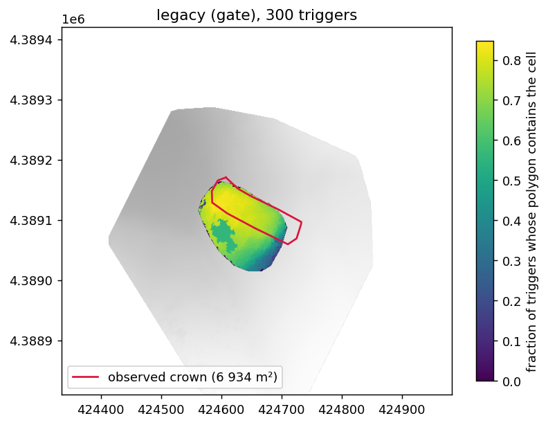
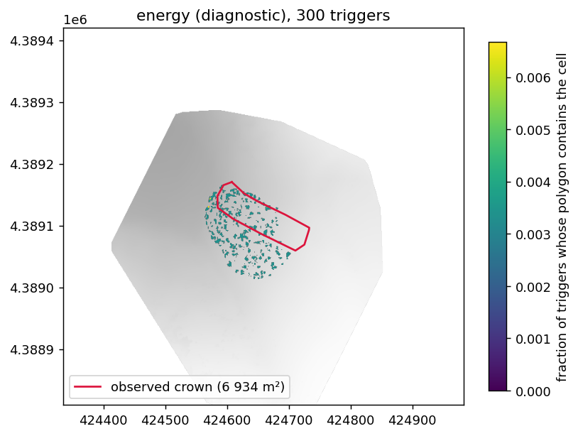
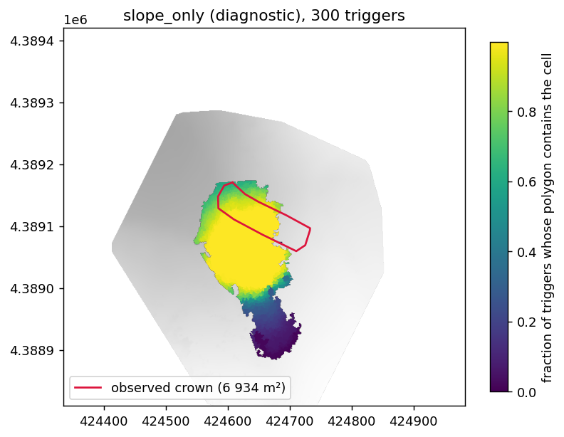
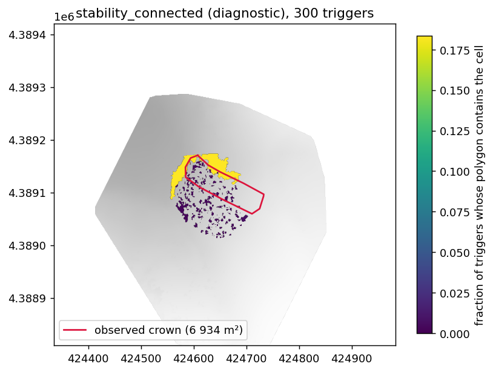

# Path-energy arrest mode: Jan 18 2026 results

Hypothesis tooling, not validated. Generated 2026-10-25 on `feat/energy-arrest`
(899eaae, 1402165, 0cdf7a0). Tables come from
`outputs/little_prof_energy/experiments/` via `src/avachain/energy_results.py`;
the runs from `src/avachain/energy_experiments.py`. Method: `docs/arrest_indices.md` §3.

## Setup

| item | value |
|---|---|
| observed crown | `data/boundaries/avalanche_release_area_20260118.geojson`, 6 934 m² (the 4 550 m² mapping is not used) |
| snapshot | 2026-01-18T00:00 (nearest zarr step to the analyze snapshot date) |
| features, energy and baselines | `outputs/little_prof_energy`: all 6 565 clusters (`analyze --feature-buffer-m 100000`), 4 712 with a weak layer |
| features, legacy in gate mode | `outputs/little_prof` (operational, 1 608 start-zone clusters) |
| energy defaults | R = 0.48 (R_FIT), δ = 0, σt = `sigma_t_mean`, E = vanherwijnen2016, G_wl = 0.2 MPa, D_wl = `wl_thickness` (sequence), τr = 0; committed in 1402165 before any run |
| lateral rule | cross-slope steps restart at N = 0 (conservative: a laterally reached cell rebuilds tension on its own fall line) |
| fixed triggers (6a) | the standalone's 2859, 5656, 6191, plus 20 clusters drawn uniformly by pixel inside the crown (seed 20260118); avachain's operational triggers (1772, 1998, 4300, 3126, 4424) are not this set |
| envelope triggers (6b) | 300 drawn from start-zone clusters with ψ ≥ 28° and a weak layer (seed 20260118) |
| δ = 1 | energy-mode rows are in the parameter tables; legacy and the baselines do not use it |
| σt relations | in-house fit and jamieson1990 (79.7 (ρ/917)^2.39 kPa, J. Glaciol. 36(122) Table III). sigrist2006 not implemented: source not obtainable |

## Step 0.4: crown clusters with no weak layer

| source | crown clusters (≥ 50 % inside) | no weak layer | cause |
|---|---|---|---|
| avachain zarr, Jan 18 | 732 | 251 | all 251: basal 1–4 elements of FCxr (code 990, median 4.7 cm) under FC; `split_wl_slab` needs FC/DH as the first element from the ground |
| standalone shipped CSV | 732 | 317 | rows hold only `hs` (profiles not on disk); 250 of avachain's 251 are among them; median HS 2.42 m vs 1.64 m with a WL |

The missing clusters have no failed `min_depth` filter, no thin snowpack and no
whole-profile FC/DH: it is the `split_wl_slab` rule, not a SNOWPACK result.
The rule is kept as is (operational choice, unchanged here).

| share of crown pixels | value |
|---|---|
| outside the start-zone KML | 0.17 |
| in a cluster with no weak layer | 0.33 |
| slope < 28° | 0.11 |

## Mode comparison, fixed triggers (6a)

Median over 23 triggers. Crown offset: pred − obs along the trigger's fall line
(+ = predicted crown lower), median of 5 cross-slope positions; flank: + =
predicted outside observed. For trigger-only polygons (energy, stability_connected)
the offsets measure the trigger position, not a crown.

| mask_mode | mode | n | area_m2 | iou_median | iou_max | over_m2 | under_m2 | crown_offset_m | flank_left_m | flank_right_m | frac_outside_mask | cap_bound |
|---|---|---|---|---|---|---|---|---|---|---|---|---|
| gate | legacy | 23 | 6238.00 | 0.39 | 0.68 | 1856.40 | 2361.30 | 4.75 | -5.16 | 30.56 | 0.00 | 0 |
| gate | energy | 23 | 11.00 | 0.00 | 0.01 | 0.00 | 6925.64 | 51.81 | -27.38 | -19.74 | 0.00 | 0 |
| gate | slope_only | 23 | 13115.00 | 0.29 | 0.29 | 8626.33 | 2444.98 | -2.59 | -4.28 | 69.24 | 0.00 | 0 |
| gate | stability_connected | 23 | 27.00 | 0.00 | 0.06 | 0.00 | 6906.64 | 37.91 | -27.38 | -19.74 | 0.00 | 0 |
| diagnostic | legacy | 23 | 9269.00 | 0.32 | 0.50 | 4735.15 | 2055.07 | 8.59 | 27.74 | 27.37 | 0.36 | 0 |
| diagnostic | energy | 23 | 11.00 | 0.00 | 0.01 | 0.00 | 6922.64 | 79.09 | -25.66 | -21.19 | 0.00 | 0 |
| diagnostic | slope_only | 23 | 20184.00 | 0.21 | 0.21 | 15491.39 | 2241.04 | -11.64 | 20.10 | 103.01 | 0.34 | 20 |
| diagnostic | stability_connected | 23 | 27.00 | 0.00 | 0.08 | 0.00 | 6906.64 | -0.23 | -24.12 | -7.22 | 0.00 | 0 |

Standalone triggers:

| trigger | mask | mode | area_m2 | iou |
|---|---|---|---|---|
| 2859 | gate | legacy | 6238.000 | 0.680 |
| 2859 | gate | energy | 2.000 | 0.000 |
| 2859 | gate | slope_only | 13115.000 | 0.288 |
| 2859 | gate | stability_connected | 533.000 | 0.060 |
| 2859 | diagnostic | legacy | 10876.000 | 0.488 |
| 2859 | diagnostic | energy | 2.000 | 0.000 |
| 2859 | diagnostic | slope_only | 20184.000 | 0.209 |
| 2859 | diagnostic | stability_connected | 3183.000 | 0.079 |
| 5656 | gate | legacy | 4467.000 | 0.583 |
| 5656 | gate | energy | 5.000 | 0.001 |
| 5656 | gate | slope_only | 13115.000 | 0.288 |
| 5656 | gate | stability_connected | 533.000 | 0.060 |
| 5656 | diagnostic | legacy | 8449.000 | 0.464 |
| 5656 | diagnostic | energy | 5.000 | 0.001 |
| 5656 | diagnostic | slope_only | 20184.000 | 0.209 |
| 5656 | diagnostic | stability_connected | 3183.000 | 0.079 |
| 6191 | gate | legacy | 3007.000 | 0.407 |
| 6191 | gate | energy | 14.000 | 0.002 |
| 6191 | gate | slope_only | 13115.000 | 0.288 |
| 6191 | gate | stability_connected | 533.000 | 0.060 |
| 6191 | diagnostic | legacy | 6474.000 | 0.319 |
| 6191 | diagnostic | energy | 14.000 | 0.002 |
| 6191 | diagnostic | slope_only | 20153.000 | 0.210 |
| 6191 | diagnostic | stability_connected | 3183.000 | 0.079 |

## Boundary mechanisms per observed segment (6a, all 23 triggers pooled)

Rejected clusters within 10 m of each observed segment, by reason. No segment is
dominated by `domain_edge`.

| mask_mode | mode | segment | n | reasons |
|---|---|---|---|---|
| diagnostic | energy | crown | 22 | energy_deficit 91%, no_weak_layer 9% |
| diagnostic | energy | flank_left | 55 | energy_deficit 75%, no_weak_layer 13%, stauchwall_slope 13% |
| diagnostic | energy | flank_right | 41 | energy_deficit 78%, no_weak_layer 20%, no_drive 2% |
| diagnostic | energy | stauchwall | 3 | stauchwall_slope 100% |
| diagnostic | legacy | crown | 136 | upslope_distance_cap 57%, meloche_arrest 39%, lateral_distance_cap 4% |
| diagnostic | legacy | flank_left | 298 | downslope_distance_cap 45%, stauchwall_slope 17%, lateral_distance_cap 16%, upslope_distance_cap 14% |
| diagnostic | legacy | flank_right | 442 | lateral_distance_cap 37%, downslope_distance_cap 34%, stauchwall_slope 19%, upslope_distance_cap 11% |
| diagnostic | slope_only | crown | 19 | no_weak_layer 100% |
| diagnostic | slope_only | flank_left | 611 | no_weak_layer 91%, stauchwall_slope 9% |
| diagnostic | slope_only | flank_right | 638 | no_weak_layer 72%, stauchwall_slope 28% |
| diagnostic | slope_only | stauchwall | 3 | stauchwall_slope 100% |
| diagnostic | stability_connected | crown | 172 | stability_stable 100% |
| diagnostic | stability_connected | flank_left | 565 | stability_stable 95%, stauchwall_slope 5% |
| diagnostic | stability_connected | flank_right | 70 | stability_stable 100% |
| diagnostic | stability_connected | stauchwall | 3 | stauchwall_slope 100% |
| gate | energy | crown | 22 | energy_deficit 73%, outside_start_zone 27% |
| gate | energy | flank_left | 55 | energy_deficit 71%, outside_start_zone 29% |
| gate | energy | flank_right | 41 | energy_deficit 78%, no_weak_layer 20%, no_drive 2% |
| gate | energy | stauchwall | 3 | outside_start_zone 100% |
| gate | legacy | crown | 255 | outside_start_zone 68%, upslope_distance_cap 20%, meloche_arrest 11%, lateral_distance_cap 1% |
| gate | legacy | flank_left | 751 | outside_start_zone 92%, lateral_distance_cap 3%, downslope_distance_cap 3%, upslope_distance_cap 2% |
| gate | legacy | flank_right | 423 | lateral_distance_cap 34%, downslope_distance_cap 30%, stauchwall_slope 19%, upslope_distance_cap 10% |
| gate | slope_only | crown | 320 | outside_start_zone 100% |
| gate | slope_only | flank_left | 993 | outside_start_zone 74%, no_weak_layer 26% |
| gate | slope_only | flank_right | 642 | no_weak_layer 69%, stauchwall_slope 25%, outside_start_zone 6% |
| gate | slope_only | stauchwall | 3 | outside_start_zone 100% |
| gate | stability_connected | crown | 45 | stability_stable 60%, outside_start_zone 40% |
| gate | stability_connected | flank_left | 263 | stability_stable 51%, outside_start_zone 49% |
| gate | stability_connected | flank_right | 49 | stability_stable 100% |
| gate | stability_connected | stauchwall | 3 | outside_start_zone 100% |

## Trigger-sensitivity envelope (6b)

| mode | mask_mode | n | with_polygon | area_median | iou_median | iou_max | cap_bound |
|---|---|---|---|---|---|---|---|
| energy | diagnostic | 300 | 300 | 7.00 | 0.00 | 0.00 | 0 |
| legacy | gate | 300 | 300 | 11362.50 | 0.36 | 0.68 | 0 |
| slope_only | diagnostic | 300 | 300 | 20291.00 | 0.21 | 0.21 | 299 |
| stability_connected | diagnostic | 300 | 300 | 9.00 | 0.00 | 0.08 | 0 |

| mode | share of crown pixels covered by any trigger | uncovered crown: no WL | uncovered: outside KML |
|---|---|---|---|
| legacy (gate) | 0.83 | 0.88 | 0.99 |
| slope_only (diagnostic) | 0.68 | 1.00 | 0.46 |
| energy (diagnostic) | 0.12 | 0.38 | 0.19 |
| stability_connected (diagnostic) | 0.21 | 0.42 | 0.20 |

slope_only: 299 of 300 polygons are bounded by MAX_BFS_CLUSTERS, not by terrain.
Energy does not beat slope_only on IoU or crown position.

GeoTIFFs: `outputs/little_prof_energy/experiments/envelope_*.tif`.

## Parameter sensitivity (Step 8, one at a time)

ln Π = ln(R G_slab / G_c) over clusters with a weak layer, inside vs outside the
crown, and in a 10 m band either side of its boundary. `crosses_at_boundary`:
Π ≥ 1 in most of the inside band and in less than half of the outside band.

| param | value | lnPi_in_p10 | lnPi_in_p50 | lnPi_in_p90 | lnPi_out_p50 | frac_Pi_ge1_in | frac_Pi_ge1_out | band_frac_Pi_ge1_in | band_frac_Pi_ge1_out | crosses_at_boundary |
|---|---|---|---|---|---|---|---|---|---|---|
| R | 0.3 | -2.10 | -1.59 | -0.99 | -1.22 | 0.00 | 0.10 | 0.00 | 0.00 | False |
| R | None | -1.63 | -1.12 | -0.52 | -0.75 | 0.00 | 0.14 | 0.00 | 0.00 | False |
| R | 0.7 | -1.26 | -0.74 | -0.14 | -0.37 | 0.03 | 0.24 | 0.03 | 0.07 | False |
| delta | 0.0 | -1.63 | -1.12 | -0.52 | -0.75 | 0.00 | 0.14 | 0.00 | 0.00 | False |
| delta | 1.0 | -2.33 | -1.81 | -1.22 | -1.44 | 0.00 | 0.08 | 0.00 | 0.00 | False |
| sigma_t | sigma_t_mean | -1.63 | -1.12 | -0.52 | -0.75 | 0.00 | 0.14 | 0.00 | 0.00 | False |
| sigma_t | sigma_t_wl | -2.22 | -1.83 | -1.24 | -1.50 | 0.00 | 0.00 | 0.00 | 0.00 | False |
| sigma_t | sigma_t_mean__jamieson1990 | -1.21 | -0.71 | -0.04 | -0.27 | 0.09 | 0.30 | 0.07 | 0.09 | False |
| E_relation | None | -1.63 | -1.12 | -0.52 | -0.75 | 0.00 | 0.14 | 0.00 | 0.00 | False |
| E_relation | project_fit | -0.90 | -0.38 | 0.22 | -0.00 | 0.20 | 0.50 | 0.13 | 0.27 | False |
| G_wl | 100000.0 | -2.33 | -1.81 | -1.22 | -1.44 | 0.00 | 0.08 | 0.00 | 0.00 | False |
| G_wl | 200000.0 | -1.63 | -1.12 | -0.52 | -0.75 | 0.00 | 0.14 | 0.00 | 0.00 | False |
| G_wl | 400000.0 | -0.94 | -0.43 | 0.17 | -0.05 | 0.19 | 0.46 | 0.13 | 0.26 | False |
| KWL_thickness | sequence | -1.63 | -1.12 | -0.52 | -0.75 | 0.00 | 0.14 | 0.00 | 0.00 | False |
| KWL_thickness | weakest_element | 0.12 | 0.87 | 1.33 | 0.92 | 0.95 | 0.92 | 0.92 | 0.88 | False |
| KWL_thickness | 0.04 | -0.47 | -0.20 | 0.04 | -0.08 | 0.16 | 0.44 | 0.25 | 0.46 | False |
| use_residual | False | -1.63 | -1.12 | -0.52 | -0.75 | 0.00 | 0.14 | 0.00 | 0.00 | False |
| use_residual | True | -0.27 | 0.96 | 1.91 | 1.64 | 0.83 | 0.84 | 0.81 | 0.80 | False |

Energy runs, the same 23 triggers, diagnostic mask:

| param | value | area_median | area_max | iou_median | iou_max | crown_offset_median | crown_offset_min | crown_offset_max |
|---|---|---|---|---|---|---|---|---|
| R | 0.3 | 11.00 | 35.00 | 0.00 | 0.01 | 79.09 | 9.74 | 153.36 |
| R | None | 11.00 | 35.00 | 0.00 | 0.01 | 79.09 | 9.74 | 153.36 |
| R | 0.7 | 11.00 | 35.00 | 0.00 | 0.01 | 80.25 | 9.74 | 153.36 |
| delta | 0.0 | 11.00 | 35.00 | 0.00 | 0.01 | 79.09 | 9.74 | 153.36 |
| delta | 1.0 | 11.00 | 35.00 | 0.00 | 0.01 | 79.09 | 9.74 | 153.36 |
| sigma_t | sigma_t_mean | 11.00 | 35.00 | 0.00 | 0.01 | 79.09 | 9.74 | 153.36 |
| sigma_t | sigma_t_wl | 11.00 | 35.00 | 0.00 | 0.01 | 79.09 | 9.74 | 153.36 |
| sigma_t | sigma_t_mean__jamieson1990 | 11.00 | 66.00 | 0.00 | 0.01 | 80.25 | 9.74 | 153.36 |
| E_relation | None | 11.00 | 35.00 | 0.00 | 0.01 | 79.09 | 9.74 | 153.36 |
| E_relation | project_fit | 14.00 | 179.00 | 0.00 | 0.03 | 67.75 | 9.74 | 153.36 |
| G_wl | 100000.0 | 11.00 | 35.00 | 0.00 | 0.01 | 79.09 | 9.74 | 153.36 |
| G_wl | 200000.0 | 11.00 | 35.00 | 0.00 | 0.01 | 79.09 | 9.74 | 153.36 |
| G_wl | 400000.0 | 14.00 | 140.00 | 0.00 | 0.02 | 67.75 | 9.74 | 153.36 |
| KWL_thickness | sequence | 11.00 | 35.00 | 0.00 | 0.01 | 79.09 | 9.74 | 153.36 |
| KWL_thickness | weakest_element | 6487.00 | 27662.00 | 0.07 | 0.38 | 23.33 | -57.04 | 153.36 |
| KWL_thickness | 0.04 | 15.00 | 123.00 | 0.00 | 0.02 | 51.81 | 7.10 | 153.36 |
| use_residual | False | 11.00 | 35.00 | 0.00 | 0.01 | 79.09 | 9.74 | 153.36 |
| use_residual | True | 6506.00 | 16924.00 | 0.07 | 0.36 | -7.64 | -16.34 | 153.36 |

| parameter | moves the crown by more than one cluster (~3 m)? |
|---|---|
| R, δ, σt column, σt relation | no (trigger-only polygons throughout) |
| E relation, G_wl, KWL_THICKNESS = 0.04 | no crown forms; largest polygon 123–179 m² |
| KWL_THICKNESS = weakest_element | yes: Π ≥ 1 in 95 % inside and 92 % outside the crown; areas to 27 662 m² |
| use_residual | yes: Π ≥ 1 in 83 % inside and 84 % outside; areas to 16 924 m² |

No combination gives Π crossing 1 at the observed boundary. ln Π is lower
inside the crown than outside under every variant.

## Step 9 checklist

| check | result |
|---|---|
| `pytest tests/` | 697 passed |
| legacy reproduces the reference | `tests/test_regression_jan18.py` (areas 11 309 / 10 954 / 10 458 m², identical to the 2026-10-23 rebuild) |
| synthetic-slope tests (Steps 2, 3) | pass (`tests/test_energy_propagation.py`, `tests/test_baselines.py`) |
| `domain_edge` dominates a segment | no |
| hand recomputation, 3 clusters (τ_net, G_c, G_slab) | exact match (`check.json`): 2859: 415.74 Pa, 1.921 J/m², 1.407 J/m² |
| units | τp Pa (median 2 428), h m, E_eff Pa, K_wl Pa/m, energies J/m² |
| crown medians (481 clusters with a WL) | E_eff 11.0 MPa, σt 4.63 kPa, h 1.16 m, D_wl 11.1 cm, ρ 327 → G_slab 1.03, G_c 1.45 (δ = 0), R G_slab 0.49 J/m²; Π < 1 in 100 % |

Brief's shipped-default expectation: G_slab ≈ 1.4, G_c ≈ 1.65, R G_slab ≈ 0.7, Π < 1
for most crown cells. Same sign; h is 0.4 m thinner and D_wl 3.6 cm thicker here.

## SNOWPACK input checks (start zone, 5th / 50th / 95th percentile)

| quantity | p05 | p50 | p95 |
|---|---|---|---|
| slab_thickness (m) | 0.45 | 0.93 | 1.51 |
| wl_thickness, sequence (m) | 0.054 | 0.103 | 0.212 |
| wl_weakest_thickness (m) | 0.006 | 0.014 | 0.027 |
| wl_shear_strength (Pa) | 2033 | 2365 | 2717 |
| E_eff (MPa) | 6.9 | 10.5 | 11.7 |
| sigma_t_mean (kPa) | 3.22 | 4.29 | 5.01 |
| slab_density (kg/m³) | 269 | 323 | 335 |

| check | status |
|---|---|
| WL rule `split_wl_slab` (first FC/DH sequence from the base) | fails on basal FCxr, see Step 0.4; no burial-date target added |
| `slab_thickness` sums element dz | yes (`element_thickness`) |
| `wl_thickness` / K_wl | sequence median 10.3 cm; weakest element 1.4 cm; KWL_THICKNESS = sequence in all default runs |
| zarr duplication | store deduplicated 2026-10-19, 6 565 locations; no runtime assertion added |
| timestep sensitivity of G_c, G_slab | not run |
| wind redistribution / h range | h 0.45–1.51 m (p05–p95), not uniform |
